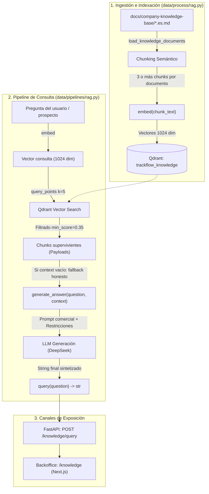

# Documento de Diseño RAG — TrackFlow Knowledge Base

Este documento describe la arquitectura, decisiones de diseño, estrategia de fragmentación, modelo de datos y calibración del sistema de **Recuperación Aumentada por Generación (RAG)** implementado para el equipo comercial y los account managers de **TrackFlow**.

---

## 1. Proceso RAG Extremo a Extremo

El sistema RAG de TrackFlow está diseñado con una arquitectura modular y desacoplada, sin frameworks de orquestación (sin LangChain ni LlamaIndex), operando directamente mediante el SDK de `qdrant-client` y el SDK de `openai` conectado al gateway de inferencia de 4Geeks.

### Flujo numerado de ejecución:

1. **Lectura de Documentos Fuente**: `setup()` lee los 4 documentos oficiales en [docs/company-knowledge-base/](../company-knowledge-base/):
   - `trackflow-carrier-coverage.es.md`
   - `trackflow-returns-policy.es.md`
   - `trackflow-sla-delivery.es.md`
   - `trackflow-storage-pricing.es.md`
2. **Chunking desde Markdown**: `chunk_document()` extrae bloques del contenido leído, no de textos de políticas fijos en código. El corpus actual produce 14 chunks (3 de transportistas, 5 de devoluciones, 3 de SLA y 3 de almacenamiento), con metadatos `company`, `source_document`, `section`, `language`, `chunk_index` y `text`. Al modificar un archivo y reindexar, se actualizan los textos y vectores almacenados.
3. **Vectorización de Ingesta**: Para cada fragmento, se llama a `embed(chunk_text)` usando el modelo dedicado de embeddings (`madrid-spain/openrouter/perplexity/pplx-embed-v1-0.6b`), obteniendo un vector denso de 1024 dimensiones.
4. **Indexación Idempotente**: Se crea o recrea la colección `trackflow_knowledge` en Qdrant con métrica `Distance.COSINE` y dimensión 1024. Los puntos se insertan con UUIDs deterministas (`uuid5`) generados con el prefijo `trackflow:{source_document}:{chunk_index}`, asegurando que volver a ejecutar `setup()` no genere puntos duplicados ni fragmentos huérfanos.
5. **Recepción de la Consulta**: El usuario envía una pregunta a través de la UI del Backoffice (`/knowledge`) o mediante el endpoint HTTP `POST /knowledge/query` de FastAPI.
6. **Recuperación con Filtrado (`retrieve`)**:
   - Se vectoriza la pregunta con la misma función `embed(question)`.
   - Se buscan los vecinos más cercanos en Qdrant (`limit=5`).
   - Se filtran aquellos resultados con similitud coseno inferior al umbral calibrado (`min_score = 0.35`).
   - Se retornan únicamente diccionarios limpios con el payload y el score.
7. **Generación con Reglas de Negocio (`generate_answer`)**:
   - Si ningún chunk supera el umbral, se devuelve de inmediato un mensaje honesto indicando que los acuerdos estándar no contienen información suficiente (evitando gastar tokens o arriesgar alucinaciones).
   - Si hay chunks relevantes, se construye el prompt con el rol de un Account Manager/Vendedor de TrackFlow en llamada comercial y se invoca al modelo de generación (`madrid-spain/openrouter/deepseek/deepseek-v4-flash`).
8. **Respuesta Final**: El endpoint responde exclusivamente con el JSON `{ "answer": "..." }`, protegiendo los fragmentos crudos y los metadatos técnicos internos de la base vectorial.

---

## 2. Estrategia de Chunking

### Justificación de la Estrategia Semántica
El corpus de TrackFlow no es un texto narrativo largo, sino un conjunto conciso de políticas operativas, compromisos contractuales, ventanas temporales, porcentajes y excepciones de personal clave.

El chunking de tamaño fijo con solapamiento (*fixed-size with overlap*) fue **descartado** porque puede cortar condiciones y reglas dependientes:
- Separar la regla de costes de devolución de su excepción por error de TrackFlow perdería información necesaria para atribuir el coste correctamente.
- Cortar el SLA del 90% separándolo de la compensación del 5% tras dos meses de incumplimiento rompería la causalidad legal.
- Dividir las fechas de alta demanda (Black Friday) separando la advertencia del incremento de tiempo (+40%) causaría promesas falsas de entregas express.

Se implementó una **extracción por encabezados y bloques separados por líneas en blanco**, adecuada al formato de estos cuatro documentos:

- Los encabezados Markdown independientes establecen el título de origen; cada payload identifica la sección como `título / bloque N`.
- Cada párrafo o lista completa se conserva sin cortar frases, elementos ni condiciones por longitud. Una introducción terminada en `:` se une al siguiente bloque (por ejemplo, al procedimiento numerado o a la lista de tarifas).
- `text` contiene el encabezado y el contenido original del bloque, sin reescribir sus valores. Solo se eliminan espacios de los extremos; no se aplica minúsculas, stemming ni normalización vectorial propia.
- No hay solapamiento ni tamaño fijo. Se requieren al menos tres chunks por documento; si no se cumple, se detiene la indexación.
- Esta estrategia presupone que el autor mantiene juntas las reglas dependientes en cada bloque. No es un parser general de todo Markdown: listas con párrafos internos o encabezados sin separación requieren revisar el formato y las pruebas antes de ampliar el corpus.

| Documento Fuente | Secciones Semánticas Identificadas | Conteo de Chunks | Contenido y Reglas Preservadas |
|---|---|:---:|---|
| `carrier-coverage` | 1. Cobertura EE. UU. (Los Ángeles) 2. Cobertura España (Zaragoza) 3. Selección y excepciones | 3 | Agrupa transportistas por país, capacidades (>5 kg, express, internacional) y la regla de excepción de Carlos Vega. |
| `returns-policy` | 1. Procedimiento estándar 2. Ventana de devolución 3. Costes y excepción 4. Devoluciones internacionales 5. Reacondicionamiento y reventa | 5 | Conserva el procedimiento numerado completo, la condición contractual de los 30 días, la excepción por error de TrackFlow y la gestión manual con Sofía Ramos. |
| `sla-delivery` | 1. Tiempos de entrega por servicio 2. Cumplimiento contractual y penalización 3. Picos de alta demanda | 3 | Preserva los plazos por servicio (3-5d, 24-48h, 7-12d), la compensación del 5% si cae del 90%, y la suspensión del SLA en Black Friday (+40%). |
| `storage-pricing` | 1. Lista de tarifas, gracia y larga duración 2. Reporte de antigüedad 3. Negociación y tarifas preferenciales (>50 m³) | 3 | Mantiene junta la lista con 18 USD, 16 EUR, gracia de 30 días y tarifa de larga duración del 150% de la estándar desde el día 181; conserva la aprobación de Miguel Torres. |

**Total actual de chunks en la colección**: 14 fragmentos. El tamaño y el conteo dependen del contenido de los Markdown; no se fuerza un número exacto de chunks mediante textos fijos.

**Idempotencia en desarrollo**: `setup()` calcula todos los embeddings antes de borrar la colección y después limpia y recarga los puntos. Un fallo de embeddings conserva la colección anterior; un fallo durante la recarga no es atómico. Los UUIDv5 dependen del documento y del índice del bloque: son estables si cambia el texto en la misma posición, pero insertar un bloque puede desplazar los índices posteriores.

**Prueba de regresión offline**: [tests/pipelines/test_rag.py](../../tests/pipelines/test_rag.py) reindexa archivos temporales con Qdrant en memoria y embeddings simulados para cada uno de los cuatro documentos. Verifica que cambiar una tarifa cambia el texto y el vector, que una regla eliminada desaparece y que los puntos conservados mantienen sus IDs sin duplicados.

---

## 3. Prácticas de Embeddings y Modelos

### Separación Estricta de Modelos (4Geeks AI Gateway)
En cumplimiento con las directrices de arquitectura y los criterios de evaluación, los modelos de vectorización e inferencia están totalmente separados:

| Responsabilidad | ID de Modelo | Proveedor / Gateway | Dimensiones |
|---|---|---|:---:|
| **Embeddings** | `madrid-spain/openrouter/perplexity/pplx-embed-v1-0.6b` | `https://llm.4geeks.ai/v1` | **1024** |
| **Generación** | `madrid-spain/openrouter/deepseek/deepseek-v4-flash` | `https://llm.4geeks.ai/v1` | N/A |

Una aserción en código (`validate_model_separation()`) valida en tiempo de ejecución tanto en `setup()` como en `embed()` que `EMBEDDING_MODEL != GENERATION_MODEL`, impidiendo cualquier reutilización indebida del modelo de generación para tareas de cálculo vectorial.

### Consistencia en `embed()`
La función `embed(text: str) -> list[float]` en [data/process/rag.py](../../data/process/rag.py) es la **única fuente de verdad** para la transformación texto $\rightarrow$ vector:
- Se invoca durante la indexación inicial en `setup()` para vectorizar el cuerpo de cada chunk.
- Se invoca de forma idéntica en `retrieve(query)` para vectorizar la pregunta del usuario.
- Esto garantiza que tanto los documentos como las preguntas residan exactamente en el mismo espacio vectorial latente.

### Configuración en Qdrant
- **Colección**: `trackflow_knowledge`
- **Métrica de Distancia**: `Distance.COSINE` (similitud del coseno, óptima para vectores normalizados de representación textual densa).
- **Dimensión del Vector**: 1024 floats.

### Calibración del Umbral `min_score`
Para evitar inyectar contexto irrelevante al prompt generador, se analizó empíricamente la distribución de scores con preguntas dentro y fuera de dominio:

| Tipo de Consulta | Ejemplos Evaluados | Rango de Similitud Coseno | Decisión |
|---|---|:---:|:---:|
| **Dentro de Dominio (corpus reindexado)** | Las 12 preguntas etiquetadas de la evaluación | `0.54` — `0.82` (mejor resultado por pregunta) | **Aceptados** |
| **Fuera de Dominio** | *"¿Cuánto cuesta el menú del restaurante?"*, *"¿Quién ganó la Champions en 2022?"*, *"¿Cómo reparar una bicicleta?"* | `0.10` — `0.22` | **Rechazados** |

Se fijó un umbral **`min_score = 0.35`**:
- Ofrece un margen de seguridad amplio respecto a las consultas fuera de dominio ($0.22 < 0.35$).
- Conserva el chunk esperado en las 12 preguntas evaluadas tras reindexar. Esto no garantiza que todos los resultados sobre el umbral sean relevantes para cualquier pregunta.
- Si ningún fragmento supera `0.35`, `retrieve()` retorna una lista vacía `[]`, activando el fallback honesto del asistente.

Las consultas fuera de dominio se calibraron con la indexación anterior; sus scores no se han vuelto a medir tras este cambio de chunking. El umbral se mantiene como valor inicial y deberá revisarse con más preguntas, especialmente consultas cercanas al dominio sin respuesta documentada.

---

## 4. Métricas de Evaluación y Calidad

En [data/eval/measure_rag_recall.py](../../data/eval/measure_rag_recall.py) se ejecuta una evaluación contra [data/eval/test-queries.json](../../data/eval/test-queries.json) (12 preguntas de negocio). Un acierto requiere que coincidan tanto `source_document` como `chunk_index` con `expected_document` y `expected_chunk_index` entre los tres resultados tras aplicar `min_score=0.35`. Encontrar otro bloque del mismo documento no cuenta.
- **Recall@3 reportado el 2026-10-14 tras reindexar**: **100.00%** (12/12 consultas recuperaron el chunk esperado en el Rank #1).
- **Objetivo mínimo del CONTEXT**: $\ge 80\%$.
- **Faithfulness**: El prompt restringe la respuesta exclusivamente a las políticas descritas. Recall@3 evalúa recuperación, no demuestra fidelidad de las respuestas generadas; esta requiere una evaluación separada.

Desde la raíz, ejecutar `uv run python -m pytest tests/pipelines/test_rag.py` para las pruebas offline y `uv run python data/eval/measure_rag_recall.py` para la evaluación real (requiere Qdrant activo, corpus indexado y acceso al modelo de embeddings de 4Geeks). Si cambia el orden de los bloques, revisar las etiquetas esperadas contra el Markdown, no ajustarlas a los resultados para inflar la métrica.
