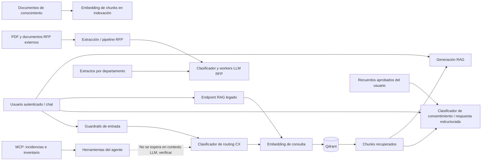

# TrackFlow — Seguridad por diseño para sistemas con IA

**Estado:** auditoría e implementación en curso  
**Fecha de inicio:** 2026-11-15  
**Alcance de negocio:** briefing TrackFlow proporcionado por el usuario en esta conversación. No existe `briefing.md`/`BRIEFING.md` como archivo en el checkout; el contenido pegado en la conversación se toma como referencia funcional, contrastado con el código y la documentación del monorepo. No se deducen políticas o estado de despliegue que esas fuentes no acrediten.  
**Evidencia:** análisis estático y pruebas locales del repositorio. No equivale a una certificación, auditoría legal, prueba de producción ni evaluación del proveedor.

> Este inventario y mapa de entradas se registran antes de los cambios de código de esta práctica. Los puntos marcados **por confirmar** se verifican durante la revisión de rutas y llamadas al modelo; no se asume que una herramienta MCP o dato operativo se envía al LLM por el mero hecho de estar conectado al agente.

## 1. Mapa de entradas externas que llegan a modelos

### Registro por flujo/modelo

| ID | Entrada externa y punto de entrada | Qué se envía a un modelo | Componente/ubicación | Tratamiento y límites conocidos |
|---|---|---|---|---|
| LLM-01 | Texto del usuario en `POST /agent/query` | La consulta después de validación determinista entra en el clasificador de routing; si corresponde, también se usa para embeddings y generación documental. | `services/support_agent/api.py`, `guardrails.py`, `routing.py`, `graph.py` | Requiere usuario autenticado; máximo 10,000 caracteres y rate limit por actor (20/minuto configurable). Usa Redis compartido si `SUPPORT_AGENT_RATE_LIMIT_REDIS_URL` o `REDIS_URL` existe; en caso contrario, el fallback es por proceso. |
| LLM-02 | Mensajes del usuario enviados por WebSocket de chat | El texto del evento `user_message` llega a `runtime.stream` y sigue el grafo CX, con routing, RAG/memoria según corresponda. | `services/support_agent/chat_api.py`, `runtime.py`, `graph.py` | Sesión autenticada y ligada al usuario; 10,000 caracteres y límite compartido con `/agent/query`. Backend Redis si se configura; fallback local. La pub/sub de chat sigue siendo local. |
| LLM-03 | Texto de documentos de la base semántica | Chunks recuperados se incluyen como datos no confiables en generación; en indexación, los documentos se envían al modelo de embeddings. | `docs/company-knowledge-base/`, `data/process/rag.py`, `data/pipelines/rag.py` | Riesgo de inyección indirecta. Un test local de documento hostil ya existe, pero usa modelo simulado; verificar su alcance y registrar esa limitación. |
| LLM-04 | Memoria del agente | Propuesta pendiente estructurada y mensaje actual para clasificar consentimiento; pregunta, documentos recuperados y recuerdos aprobados como datos auxiliares en generación estructurada. | `services/support_agent/memory.py` | La memoria se aísla por actor y requiere consentimiento; verificar redacción/retención y asegurar que el contenido recuperado se mantiene no confiable. |
| LLM-05 | Consulta al endpoint RAG legado | Pregunta como embedding y junto con chunks relevantes para generación de respuesta. | `POST /knowledge/query` / aliases publicados, `services/api/routes/knowledge.py`, `data/pipelines/rag.py` | Autenticación existente se mantiene; máximo 10,000 caracteres y rate limit por identidad añadidos. Ambos aliases usan el mismo router y backend configurado (Redis o local). |
| LLM-06 | PDFs/Markdown y extractos externos de solicitudes RFP | Texto extraído para clasificación y contenido segmentado por workstream para generación de propuestas/respuestas. | `data/pipelines/rfp_intake/`, `data/pipelines/rfp_response_generation.py`, `services/api/routes/rfp_intake.py`, Celery | Se documenta como entrada no confiable y existen gates de revisión. La detección determinista de inyección no es completa; verificar cada invocación y salida antes de persistir. |
| LLM-07 | Salidas de herramientas MCP | MCP expone incidencias y lecturas de inventario al agente. La implementación documentada combina/renderiza los resultados operativos determinísticamente y no los pasa al contexto RAG. | `mcps/trackflow_tools_mcp/`, `services/support_agent/tools.py`, `graph.py` | No se considera entrada al modelo salvo evidencia en un camino concreto. Confirmar prompts/caminos de memoria, registrar esquemas y probar que texto hostil de una herramienta no habilita acciones. |

**Proveedores:** la configuración del repositorio apunta al gateway LLM configurado por entorno (4Geeks en documentación RAG) y proveedores/modelos de embedding/generación. Qdrant es almacenamiento de vectores; no se le atribuye inferencia. Los contratos, residencia, retención, subprocesadores y garantías del proveedor no están verificados en este ciclo.

## 2. Inventario de sistemas de IA y responsabilidades

Las personas se asignan según el briefing y la estructura de TrackFlow; requieren confirmación organizativa. Andrés Kim/equipo de Tecnología mantiene el control de aplicación, identidad, permisos, configuración y despliegue. El proveedor externo controla la operación de su servicio según contrato, pero no sustituye las responsabilidades de TrackFlow sobre autorización, minimización, prompts, secretos y uso del resultado.

| Componente | Estado y ubicación | Responsable negocio | Responsable técnico | Terceros y control retenido por TrackFlow |
|---|---|---|---|---|
| Agente CX y chat/memoria | Implementado: `services/support_agent/`; API, WebSocket, routing, RAG, herramientas y memoria consentida. | Valentina Cruz | Andrés Kim + equipo de Tecnología | Gateway/modelo: disponibilidad y seguridad del servicio contratado; TrackFlow controla datos enviados, prompt, autenticación, ACL, salida y retención. |
| RAG de políticas/SLA | Implementado: `data/pipelines/rag.py`, `data/process/rag.py`, corpus `docs/company-knowledge-base/`. | Valentina Cruz; Miguel Torres para contenido B2B (confirmar) | Andrés Kim + equipo de Tecnología | Gateway de embeddings/generación y Qdrant/infraestructura: responsabilidades contractuales por verificar. TrackFlow controla corpus, tenant, acceso y publicación. |
| MCP de operaciones | Implementado: `mcps/trackflow_tools_mcp/`; tools de incidencias (lectura/escritura de ciclo) e inventario (solo lectura). | Ana Whitfield (inventario) / Carlos Vega (incidencias) | Andrés Kim + equipo de Tecnología | Proveedor OIDC/infraestructura si externo. TrackFlow controla OAuth/scopes, token de servicio, allowlist de rutas, autorización y datos devueltos. |
| Selección de carrier | Skill documentada: `skills/carrier-selection-optimizer/`; no se ha confirmado motor LLM operativo que confirme despachos. | Carlos Vega | Andrés Kim + equipo de Tecnología | Couriers son terceros de transporte e integración. TrackFlow conserva selección, reglas, credenciales y validación; integración productiva/confirmación de despacho pendientes de verificar. |
| Triage/aprobación de devoluciones | Skill documentada: `skills/returns-triage-assistant/`; no se confirmó motor automático productivo. No confundir con RFP approval. | Sofía Ramos | Andrés Kim + equipo de Tecnología | Si se invoca un proveedor, TrackFlow mantiene reglas, autorización y decisión final. Gate real para devoluciones de alto valor pendiente de confirmar. |
| RFP intake, workers y aprobación de propuestas | Implementado en `data/pipelines/rfp_*`, API y Celery; clasificación/generación con gates humanos. No es aprobación automática de devoluciones. | Miguel Torres; propietarios de áreas Ana Whitfield/Carlos Vega (confirmar) | Andrés Kim + equipo de Tecnología | Gateway LLM y extracción de PDF/terceros según configuración. TrackFlow controla documentos, permisos, revisión y publicación. |
| Ingesta de PDFs/extracción para RFP | Pipeline auxiliar al workflow RFP; texto derivado alimenta clasificación/generación. | Miguel Torres / solicitante comercial | Andrés Kim + equipo de Tecnología | Proveedor de extracción/conversión si aplica, por confirmar. TrackFlow controla archivos, límites, sanitización, autorización y retención. |
| Tareas Celery que invocan pipelines de IA | Worker compartido ejecuta intake/respuestas RFP; no se identificó agente autónomo aparte. | Propietario del proceso que solicita la tarea | Andrés Kim + equipo de Tecnología | Redis/infraestructura y proveedor LLM según despliegue; TrackFlow controla permisos, reintentos, auditoría y estado. |

### No afirmar como sistemas desplegados sin evidencia

El briefing menciona motor de selección de carrier, RAG separado y motor de aprobación de devoluciones. En el fork hay skills de carrier/devolución y un RAG operativo, pero el motor automático que modifica envíos/aprueba devoluciones no está confirmado en código inspeccionado. El inventario refleja tanto los componentes descritos en el briefing como su estado comprobable en el repositorio.

## 3. Contexto regulatorio y datos

Según el briefing TrackFlow entregado para esta práctica:

- **RGPD (España/UE):** aplica a datos personales de destinatarios y datos de marcas; el briefing establece notificación a la AEPD dentro de 72 horas ante una brecha con riesgo para los derechos de las personas.
- **CCPA/CPRA (California):** derechos de acceso, eliminación y opt-out; notificación razonablemente rápida ante brechas, según el briefing.
- Datos sensibles destacados: contacto y direcciones de destinatarios finales B2C; datos contractuales y de volumen de marcas B2B, a menudo confidenciales por contrato.
- Evidencia de pruebas debe ser sintética o redactada. La aplicabilidad y plazos concretos deben validarse con Legal/Compliance; este informe no es asesoramiento legal.

**Inconsistencia de contexto a resolver:** el briefing de esta práctica indica Los Ángeles y Zaragoza; `CONTEXT.md` del checkout describe México y España, y la memoria histórica del repositorio menciona EE. UU. y España. Las conclusiones geográficas/regulatorias de este informe siguen el briefing de la práctica hasta que negocio confirme la fuente de verdad.

## 4. Matriz NIST CSF — evaluación inicial y plan

Priorización inicial: **P0** antes de producción o ante exposición actual; **P1** siguiente ciclo; **P2** mejora planificada. El estado se actualizará con pruebas; una acción propuesta no equivale a control verificado.

| Función | Estado / brecha inicial | Acción concreta y prioridad | Evidencia de cierre esperada |
|---|---|---|---|
| **Govern** | Propietarios preliminares; asignaciones, política de retención, proveedores y aceptación de riesgos requieren aprobación de negocio. | **P1:** confirmar owners y matriz RACI para CX, RAG, MCP, RFP, carriers y devoluciones; revisar DPA/subprocesadores y aprobar quién puede autorizar acciones de alto impacto. | Aprobación de responsables y contratos/políticas referenciados, sin secretos. |
| **Identify** | Inventario y mapa de entrada LLM registrados aquí; falta validar aliases API, proveedores/retención e inventario de datos y flujos B2B/tenant. | **P0:** completar inventario con responsable técnico/negocio, terceros, datos, endpoint y estado de despliegue; verificar entradas en grafo y OpenAPI. | Este inventario revisado y evidencia de búsqueda de rutas/call sites. |
| **Protect** | Guardrails CX, OAuth/scopes MCP, validaciones RFP y credenciales por entorno; rate limit con opción Redis compartida y control de longitud. La ruta de salida de inventario tiene confirmación explícita; no todas las acciones irreversibles del briefing están implementadas o verificables. | **P0 parcial:** probar inyección y ACL B2C/B2B con fixtures sintéticos; verificar controles humanos de mutaciones existentes; obtener los flujos/políticas aprobados para acciones no presentes; confirmar Redis en despliegues multiworker. | Tests focalizados locales; Compose configura Redis bajo perfil `dev`, lo cual no acredita configuración productiva. |
| **Detect** | Hay trazas estructuradas de agente y eventos MCP; las trazas live omiten pregunta, respuesta y payload de nodos por defecto. Checkpoints y chat aún pueden retener contenido; retención, alertas y acceso a logs no verificados. | **P1:** definir acceso, retención, alertas y política de habilitación temporal de contenido en trazas; revisar almacenamiento de checkpoints/chat. | Test local de traza live redactada y revisión estática del logger MCP; configuración/retención de despliegue por validar. |
| **Respond** | Procedimiento y SLA organizativo no verificados. | **P1:** redactar playbook de incidente IA/datos con contención, preservación de evidencia, evaluación de riesgo y escalado a Legal/Compliance; reflejar el plazo AEPD de 72h del briefing y notificación CCPA/CPRA razonablemente rápida. | Runbook aprobado y ejercicio de mesa con responsables. |
| **Recover** | Backups/restauración de datos de agente, Qdrant, DB y secretos no demostrados. | **P2:** documentar restauración por servicio, RPO/RTO, rotación/revocación de credenciales tras incidente y prueba periódica, sin restaurar secretos comprometidos. | Evidencia fechada de restauración y validación de integridad/ACL. |

## 5. Carril OWASP para sistemas agénticos

El baseline OWASP existente está en `docs/security/owasp-top10-baseline-2026-11-14.md`; el progreso y límites en `docs/security/owasp-top10-progress-2026-11-14.md`. Se mantienen separados de la evaluación NIST.

| Riesgo priorizado del briefing | Evidencia actual a verificar | Brecha/acción de esta auditoría |
|---|---|---|
| **A01 Broken Access Control**: usuario B2C solicita pedido ajeno o B2B consulta otra marca. | El agente falla cerrado para lookups de tracking y ahora para consultas de dirección de entrega, al no disponer de verificación de ownership; los tests offline incluyen pedido sin ownership verificable y la petición literal del briefing de dirección ajena. Se rechazan antes de routing/tools. MCP aplica scopes. No hay prueba que demuestre consulta autenticada de pedido con ownership ni aislamiento tenant B2B de extremo a extremo. | Mantener bloqueo de tracking/direcciones mientras no haya verificación de propiedad; ampliar tests sintéticos cross-user/cross-tenant al implementarse rutas con ACL. No afirmar que la prueba actual demuestra aislamiento E2E. |
| **A02 Cryptographic Failures**: claves de gateway/courier y secretos webhook. | Variables de entorno y plantillas están documentadas; no se inspecciona `.env`. Falta escaneo global/historial, rotación y TLS productivo verificados. | Búsqueda segura sin exponer valores; corregir sólo secretos reales encontrados en archivos versionados y proponer rotación si hubo exposición. |
| **A03 Injection**: prompt directo, documento RAG o resultado de tool hostil. | Hay guardrail directo y prueba RAG offline con LLM simulado. La fixture RAG confirma que texto hostil serializado como dato no confiable no causa llamadas a tools dentro del test; no acredita comportamiento de un proveedor real. | Mantener fixtures sintéticos y ampliar casos solo en rutas/modelos existentes. El caso de nota hostil del selector de carrier no puede probarse contra un motor operativo no encontrado en este fork. |
| **A05 Security Misconfiguration / excessive agency**: confirmar despacho de alto valor, cambio de carrier en tránsito, aprobar devolución de alto valor o compartir datos B2B. | La ruta de salida de inventario requiere rol admin y `X-TrackFlow-Human-Confirmation: confirmed`; no consta condición de importe ni validación de coste/reglas. No se encontraron rutas/servicios para las otras tres acciones. El flujo de aprobación RFP es distinto. | El requisito de que las cuatro acciones requieran confirmación humana no está satisfecho/demostrado. Mantener el gate existente, no afirmar que cubre envío de alto valor. Implementar otros gates solo cuando existan sus flujos y el negocio defina política y aprobación; se requieren, entre otros, umbral monetario, reglas de carrier, criterio de tránsito y autorización de sharing B2B. |
| Logging/monitorización (OWASP A09) | Trazas live CX redacted por defecto; eventos MCP no registran argumentos/tokens. Checkpoints y chat pueden persistir contenido; acceso, retención y alertas de producción pendientes. | Probar la redacción parcial; acordar controles operativos también para checkpoints, chat y capturas con contenido habilitado. |
| Rate limiting de modelo | Implementado en `/agent/query`, chat WebSocket y RAG legado por ID autenticado; 20 solicitudes por 60 s por defecto. Redis compartido si configurado, de lo contrario process-local. | Pruebas de transporte y unidad local. Compose declara Redis en perfil `dev`, no se ha verificado el despliegue productivo o multiworker. |

## 6. Hallazgos y riesgos abiertos

| ID | Riesgo | Mitigación/seguimiento | Estado |
|---|---|---|---|
| R-01 | Bypass de cuota entre procesos/replicas si se usa backend local o Redis no está configurado en el despliegue. | Rate limit por identidad implementado en `/agent/query`, chat WebSocket y `/knowledge/query`; Redis Lua implementa ventana deslizante atómica si existe `SUPPORT_AGENT_RATE_LIMIT_REDIS_URL` o `REDIS_URL`. Fallo del backend configurado devuelve 503 (fail-closed), no fallback silencioso. | Código y pruebas locales; Compose muestra Redis bajo perfil `dev`. Configuración/operación productiva no demostrada. |
| R-02 | Inyección indirecta podría tratar texto de documentos/herramientas como instrucciones. | Separación system/data, guardrails antes y después, datos tipados, permisos de herramienta por servidor y regresiones hostiles; no depender solo de regex/modelo. | Parcial; suite local no demuestra seguridad universal. |
| R-03 | Secretos pueden existir en historial, artefactos o despliegue aunque el código use variables de entorno. | Escaneo de patrones/secret scanning sin imprimir contenido; revisar historial y proveedor fuera de alcance local; rotar cualquier secreto real expuesto. | Pendiente de auditoría integral. |
| R-04 | El briefing exige confirmación humana para cuatro acciones irreversibles; el repo solo demuestra gate admin + confirmación textual para salida de inventario, sin regla de alto valor. No se localizaron los otros tres flujos. | No presentar el control parcial como cumplimiento del requisito. Para completar: identificar rutas productivas y owner; definir umbral monetario, validaciones de coste/reglas, criterio para cambio de carrier en tránsito y autorización de sharing intermarca. | **Requisito del briefing no satisfecho en su totalidad / no demostrable en este fork.** RFP no sustituye aprobación de devoluciones. |
| R-05 | Checkpoints/chat, u opt-in de trazas, podrían contener PII/prompts; acceso, retención y durabilidad operacional no verificados. | Trazas live redactan contenido por defecto; `SUPPORT_AGENT_TRACE_CONTENT` puede habilitarlo. Definir controles para ese opt-in y para las bases de checkpoints y chat. | Redacción de trazas probada localmente; no es redacción integral ni evidencia de configuración operacional. |
| R-06 | Proveedores de LLM/embeddings, extracción PDF, Qdrant, OAuth y carriers tienen condiciones de retención/ubicación no comprobadas. | Revisión contractual/DPA, subprocesadores, residencia, retención, notificación, borrado y responsabilidad compartida. | Abierto; requiere Compliance/Legal. |
| R-07 | `CONTEXT.md` indica México y España; el briefing compartido en conversación y `.memory-bank/projectbrief.md` indican Los Ángeles/EE. UU. y Zaragoza/España. No hay archivo de briefing en el checkout. | Confirmar contexto oficial antes de aplicar conclusiones jurisdiccionales o de residencia. | Abierto; briefing disponible en conversación pero ausente como archivo. La discrepancia con `CONTEXT.md` permanece. |
| R-08 | HTTPS, firewall, SSH no-root, backups y recuperación de producción no se prueban desde este checkout. | Evidencia del operador/infraestructura y prueba de restauración; no afirmar que Compose local describe producción. | Fuera de verificación local. |

## 7. Evidencia y comandos reproducibles

Evidencia local ejecutada en el checkout de esta rama; no se conectó a proveedor LLM ni a entorno productivo:

- `uv run --no-sync python -m pytest tests/pipelines/test_support_agent.py tests/pipelines/test_support_agent_rate_limit.py tests/test_chat_transport.py -q` → pendiente de ejecutar tras añadir el rechazo específico de consultas de dirección de entrega ajena. Incluye pruebas HTTP para endpoints de agente y validación de longitud de RAG, evento de rate limit en WebSocket, limitador Redis con cliente simulado y redacción de trazas live. Las pruebas de integridad de contexto/inyección usan cliente LLM simulado.
- Búsqueda de patrones comunes de secreto sobre archivos fuente versionados (excluyendo tests y documentación), con valores nunca impresos → **0 posibles coincidencias**. No se leyó `.env`, no se examinó historial Git completo ni secretos de CI/despliegue; no es un escaneo exhaustivo.
- `git diff --check` → sin errores tras los cambios.

**Límites y puntos no implementables/verificables desde este checkout:**

- Redis es condicional: si no se configura `SUPPORT_AGENT_RATE_LIMIT_REDIS_URL` ni `REDIS_URL`, el limitador permanece por proceso. Compose contiene Redis en perfil `dev`; no hay evidencia de la configuración en producción, así que no se afirma cuota global desplegada. Cuando Redis está configurado y falla, el control responde 503.
- La redacción aplica a trazas estructuradas live; `SUPPORT_AGENT_TRACE_CONTENT` permite opt-in de contenido. No se implementó redacción de checkpoints LangGraph ni del historial/base de chat, que pueden guardar preguntas, contexto y mensajes. Su retención, ACL, cifrado/backups y operación requieren decisión/evidencia del operador.
- Las rutas/servicios inspeccionados no muestran cambios de carrier, aprobación de devolución de alto valor ni compartición cross-brand. Sin APIs, política de autorización y requisitos funcionales verificables no se añadieron gates ficticios. La ruta real de despacho de inventario sí exige admin y `X-TrackFlow-Human-Confirmation: confirmed`; RFP tiene revisión humana propia, no equivalente a aprobación de devoluciones.
- `briefing.md`/`BRIEFING.md` no está en el checkout. Se conserva como referencia funcional únicamente lo recibido en la conversación y no se inventan requisitos ausentes. La geografía declarada difiere entre fuentes y queda pendiente de confirmación.
- Contratos/DPA, residencia y retención de proveedores; responsables organizativos; política legal definitiva; alertas de producción; controles de acceso/retención operacional; ejercicio de respuesta y recuperación RPO/RTO no se pueden certificar desde código local. Requieren confirmación de Legal/Compliance, negocio y operaciones.
- Los tests de prompt injection usan un LLM simulado; no prueban comportamiento de proveedor real. Ningún resultado equivale a garantía frente a prompt injection, certificación ni validación de producción.

- Informe de línea base OWASP: [`owasp-top10-baseline-2026-11-14.md`](../owasp-top10-baseline-2026-11-14.md)
- Progreso OWASP: [`owasp-top10-progress-2026-11-14.md`](../owasp-top10-progress-2026-11-14.md)
- RFP: [`rfp-intake-security.md`](../rfp-intake-security.md)
- Agente y memoria: [`AGENT_MEMORY.md`](../AGENT_MEMORY.md), `services/support_agent/README.md`
- MCP: `mcps/trackflow_tools_mcp/README.md`
