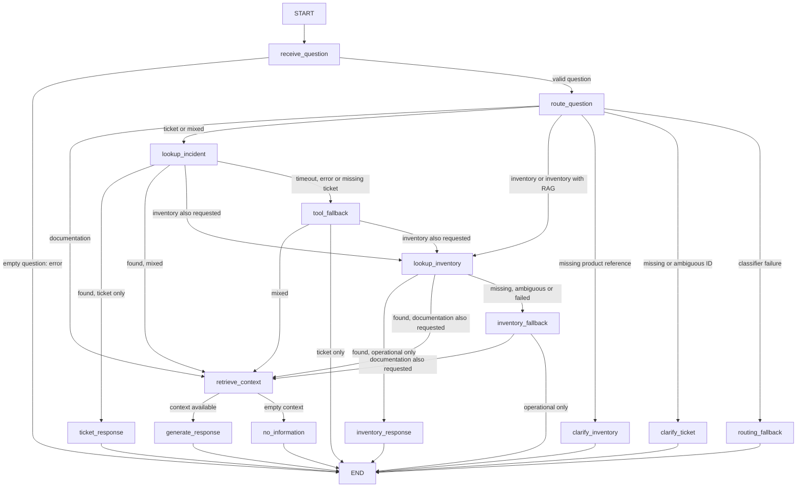

# TrackFlow Support Agent - Parts 1 and 2

LangGraph orchestration of the existing RAG and separate read-only tools for the
real incidents and inventory APIs. No conversation memory, automatic retries or
changes to the RAG corpus, models, prompts, top-k or score threshold are introduced.

## Graph and state



  `AgentState` contains `question`, `context`, `answer`, `error`, a typed routing
  decision, typed ticket/inventory results, and routing/knowledge failure flags. Pydantic
  validates types at runtime; no chat history, credentials or clients travel in state.
  The classifier uses the existing configured generation model with validated JSON
  output. It selects documentation, incidents, inventory or combinations without source instructions
  from the user. Missing/ambiguous IDs request clarification; an ID absent from the
  question is rejected. Classifier errors never default to the RAG.
  The retrieval node calls `data.pipelines.rag.retrieve` once, using only the
  documentation question extracted by the router. The generation node calls
  `generate_answer(question, context)` with those recovered chunks.
`no_information` reuses the existing empty-context fallback, without an LLM call.
`embed` remains the existing function imported by the RAG pipeline. The old
`query` remains in use by the old endpoint; the graph never calls it.

  `IncidentTool` accepts `TicketInput(ticket_id: int > 0)` and returns `TicketResult`:
  `outcome` plus an `Incident` only when found. The incident mirrors `IncidentResponse`
  (`id`, `title`, `description`, `category`, `status`, `origin`, `branch`, `created_at`,
  `updated_at`). Outcomes are `found`, `not_found`, `timeout`, `unauthorized`,
  `unavailable`, and `invalid_response`. A mismatched ID or invalid JSON is rejected.
  The tool exclusively calls `GET /api/incidents/{id}`; it never writes to TinyDB,
  indexes tickets, follows redirects, or calls a write endpoint. The existing
  detail endpoint is uncached; cached list/filter search is outside this increment.

  Each lookup has a **5.0-second total deadline**, including connection/read time,
  plus explicit HTTPX timeouts, with no retries. Tool errors enter `tool_fallback`
  and produce an honest answer, not a failed run or an invented ticket status.
  A 404 is distinguished from an unavailable service. Mixed queries run incidents
  before the RAG; their response deterministically combines validated ticket facts
  and the documentation answer. Ticket data never becomes RAG context. Either
  source may fail without discarding the other source's available answer.

### Inventory tool

`InventoryTool` has its own `InventoryInput` and `InventoryResult`; it never
queries tickets. Input selects exactly one positive `product_id`, literal
`sku_code` or `product_name`, optionally filtered by `warehouse` (`LA`, `ZGZ`)
and `category` (`fashion`, `electronics`, `cosmetics`). Missing identifiers
request clarification; model-generated identifiers absent from the question are
rejected. A numeric SKU suffix is not treated as a product ID.

The tool only reads `GET /inventory/products/{id}` or `GET /inventory/products`.
SKU/name matching filters the real API response, not a parallel dataset. Exact
names are preferred before case-insensitive substring matching. Multiple matches
produce `ambiguous` with at most ten candidates and a clarification question,
never a summed or guessed stock. Zero stock remains a valid found result.

Each returned `InventoryProduct` mirrors `SKUResponse`: `id`, `name`, `sku_code`,
`client_name`, `category`, `warehouse`, `threshold_min`, `current_stock`,
`created_at`. Outcomes are `found`, `not_found`, `ambiguous`, `timeout`,
`unauthorized`, `unavailable`, `invalid_response`. Product/stock facts are
rendered deterministically and never passed as RAG context.

Inventory has a separate **5.0-second total deadline**, no retries or redirects,
and explicit `inventory_fallback`. The existing API's 30-second product cache
is retained and invalidated by its product/movement writes; the tool adds no
cache and reports the stock returned by that API, not a stronger freshness claim.

The source decisions are `rag`, `incidents`, `both` (incidents + RAG), `inventory`,
`inventory_rag`, `operations` (incidents + inventory), `all`. Requested sources
run in the fixed order **incidents -> inventory -> RAG**, skipping unneeded
sources. Each tool remains single-purpose. Failures preserve other available
answers without inventing a ticket status or stock count.

Initialization explicitly compiles the graph before accepting HTTP requests.
Additional checks reject disconnected nodes, missing paths to END, implicit
conditional destinations and the wrong state schema. Compilation is not a
substitute for runtime type validation or dependency availability checks.

## HTTP

Install from the repository root:

```bash
uv sync
```

The root workspace declares `packages/shared-py` as a local editable dependency.
`uv sync` therefore installs `trackflow_shared` automatically, including the
dependency required by the unified API integration test. A manual `uv pip install`
or `--no-sync` workaround is not required.

The unified API includes `POST /agent/query`, alongside `POST /knowledge/query`.
It can also run independently of the rest of the API:

```bash
uv run uvicorn support_agent.api:app --app-dir services --host 0.0.0.0 --port 8001
curl -X POST http://localhost:8001/agent/query \
  -H 'Content-Type: application/json' \
  -d '{"question":"Cual es la tarifa de almacenamiento en Zaragoza?"}'
```

Successful responses contain `answer`, `run_id` and `thread_id`, never chunks or
scores. Empty questions produce a traced `400`; invalid request bodies produce
`422`. Dependency failures produce `503`, internal graph failures `500`, with
sanitized messages and the run ID. Empty retrieval is a successful, honest
response, not an HTTP error. The adapter contains no retrieval or prompt logic.
The unified `/agent/query` endpoint requires a valid bearer for an active,
registered user; anonymous requests receive `401` before the graph runs. The
standalone adapter also fails closed unless its host injects the authenticated
user into request state. This login gate is separate from authorization to a
particular shipment: the current agent still refuses tracking lookups because
ownership verification is not available yet.

Every nonempty question needs the configured LLM for routing. Documentation also
needs the existing indexed Qdrant collection; operational-only questions do not query
Qdrant or invoke RAG answer generation. The classifier uses a 20-second HTTP
timeout with SDK retries disabled; classification failure has its own fallback.

### Tool connections and authentication

| Setting | Purpose |
| --- | --- |
| `SUPPORT_AGENT_MCP_URL` | Required MCP Streamable HTTP server URL for production graph construction without injected operational tools. |
| `SUPPORT_INCIDENTS_BASE_URL` | Legacy direct API origin for isolated compatibility tests only; default `http://127.0.0.1:8000`. |
| `SUPPORT_INVENTORY_BASE_URL` | Legacy optional inventory API origin for isolated compatibility tests only. |
| `SUPPORT_AGENT_TOKEN` | CLI/live-capture user's TrackFlow OAuth access token. The adapter sends it only as the bearer to MCP, never directly to the API. |
| `SUPPORT_INCIDENTS_TOKEN` | Backward-compatible CLI/capture fallback when `SUPPORT_AGENT_TOKEN` is absent. |

When `SUPPORT_AGENT_MCP_URL` is configured, the user's TrackFlow OAuth access token
is sent only to MCP. MCP validates its signature, issuer, audience, expiry and
per-tool scope, then calls the API with the independent `MCP_API_SERVICE_TOKEN`
service credential. Inventory remains read-only. Without a user token, no MCP
request is sent; invalid/expired tokens produce an honest access fallback. Public
RAG access is unchanged. Never put a token in the question or store it in source
control. Tokens are held only for the current locked runtime invocation and
cleared in `finally`; they never enter LangGraph state/config, checkpoints,
traces or CLI output. An environment token is read only by CLI/capture entry
points. The legacy direct API adapters remain only for isolated compatibility
tests. Falling back to them in production would bypass MCP bearer validation and
per-tool OAuth scopes, and create a second operational path with different
authentication semantics. `build_graph()` uses MCP when configured; if it is
absent, operational lookups fail closed as unavailable while RAG-only questions
continue to work. Explicitly injected tool doubles remain supported for tests.

For an authenticated query (set the variable securely outside source files):

```bash
curl http://localhost:8000/agent/query \
  -H "Authorization: Bearer ${SUPPORT_INCIDENTS_TOKEN}" \
  -H 'Content-Type: application/json' \
  -d '{"question":"En que estado esta el ticket 482?"}'
```

The backoffice `/knowledge` view calls this endpoint through `/api/agent/query`
and the existing shared authenticated client. It forwards the current session
JWT, displays structured agent errors and preserves loading/retry states. The
legacy knowledge endpoint remains available for other callers.

## Persistence and inspection

`SUPPORT_AGENT_STATE_DIR` optionally selects the state directory. The local
default is `~/.local/state/trackflow/support_agent`. Compose maps
`./data/support_agent` to `/var/lib/trackflow-agent`, surviving container
recreation. Do not delete that directory if runs must remain inspectable.

- `checkpoints.sqlite3`: official LangGraph `SqliteSaver`, checkpointing at
  superstep boundaries (one node per step in this graph).
- `traces.sqlite3`: persistent JSON documents with run/thread IDs, input,
  ordered node events, node inputs/outputs, branch destinations/reasons,
  timing, final answer, sanitized errors and a `guardrail_summary` with per-run
  activation counts by guardrail, failure category and action. Node start is persisted before
  its execution. Each resume attempt has its own run ID and the same thread ID.
- Trace metadata records graph/router/tool/RAG/corpus hashes, generation model, retrieval
  settings and whether external services were simulated.

From the repository root, inspect without rerunning the graph:

```bash
uv run python -m services.support_agent trace RUN_ID
uv run python -m services.support_agent history THREAD_ID
uv run python -m services.support_agent resume THREAD_ID
```

Use `--state-dir PATH` before the command when inspecting another directory.
Resumption continues a pending or failed checkpoint; completed threads cannot
be resumed. Independent questions always receive distinct thread IDs. Checkpoint
replay does not guarantee exactly-once external calls if a process dies between
the call and its persisted checkpoint.
Pending Part 1 RAG checkpoints without a routing decision remain resumable.
Resuming before either tool lookup requires fresh credentials; checkpointed
credentials are never recovered. A resume after a completed lookup uses its
saved result, not a freshness guarantee: submit a new question for a current read.
The ordered `sources` array and per-node `source` fields include attempted source
calls even when they fail; outcomes and explicit `next` branches explain recovery.
The trace summary counts input rejections/redirections and output blocks without
including extra question or answer content in the summary.

### TrackFlow guardrails

The harness applies deterministic input policy before memory, routing, retrieval
or tools. It rejects instruction-change attempts and personal tasks, redirects
small talk/general logistics, and fails closed on tracking requests because the
current tools do not verify shipment ownership against the authenticated actor.
This includes the briefing's unauthorized order `#45821` case: no tracking
lookup is attempted and no status is disclosed. An explicit request to apply
Spain's policy to a Los Angeles order is rejected and redirected to the actual
United States policy. Output validation blocks known internal-instruction,
carrier-rate and warehouse-location patterns. These checks are defense-in-depth;
they are not a substitute for server-side per-order authorization or a future
tracking tool that proves ownership.

Traces/checkpoints include questions, internal knowledge, ticket and product data. They are
local-only, not exposed by a public trace endpoint. Restrict directory access
and define appropriate retention/backups before production. SQLite and the
execution lock target a single-process deployment, not distributed workers.

## Evaluation

Run all pipeline tests, including existing RAG tests, with one command:

```bash
uv run python -m pytest tests/pipelines/ -q
```

The thirteen evals in `tests/pipelines/test_support_agent_evals.py` read saved traces,
not live executions. They retain the five Part 1 checks and add ticket-only
routing without RAG, documentation-only routing without tools, ordered mixed
sources, and unavailable-service fallback without an invented state.
Four additional inventory evals verify tool-only routing, inventory before RAG,
three ordered sources, and unavailable-inventory fallback without invented stock.
The grounding check compares the saved answer/context with the official policy
in `docs/company-knowledge-base/trackflow-storage-pricing.es.md`, not invented
company context. Hash mismatches require review and explicit recapture; never
change expected business facts to match an incorrect generated answer.

Other tests execute the graph offline to verify contracts, GET-only transport,
the total deadline, malformed responses, 404/401/403/5xx/network errors,
clarification and classifier fallback, token isolation, source failures in mixed
queries, legacy/resumed checkpoints, and unified API startup. An integration test
uses the real incidents router and JWT validation through HTTPX ASGI transport,
with isolated temporary TinyDB storage, and verifies that reads do not mutate it.
A second integration test exercises the real inventory router, JWT and SQLModel
queries against temporary SQLite tables: it checks stock per warehouse and
observes only SELECT statements while the tool runs.

Reference traces are **simulated**, not evidence of live-model faithfulness:
they were generated by running the real graph, router validation, HTTP tool,
RAG functions and in-memory Qdrant against the official corpus, with simulated
embeddings, LLM output and HTTP responses. No parallel ticket dataset is created:
offline operational captures return 404 or 503, not invented tickets or stock.
Regenerate explicitly, outside pytest:

```bash
uv run python tests/pipelines/capture_support_agent_traces.py --offline
```

For real captures, start the existing API and indexed Qdrant, configure model
credentials and `SUPPORT_AGENT_TOKEN`, and choose existing incident/product IDs.
Capture refuses to claim live success if either cannot be read. Live mode
never deliberately interrupts the backend; its fault eval is skipped.

```bash
uv run python tests/pipelines/capture_support_agent_traces.py --ticket-id 482 --product-id 7
uv run python -m pytest tests/pipelines/ -q
```

The capture command uses existing retrieval/generation unchanged; live mode does
not reindex or mutate the collection. Passing stored evals proves properties of
those captures, not all future answers. Live-model validation remains required
before treating the migration as production-validated.
Deployed browser E2E validation with the real API, models, indexed Qdrant and
incident data passed on desktop/mobile. Login used a temporary normal-user
account with generated credentials, deleted after validation. Ticket results
matched the real API; incident storage was unchanged and credentials were absent
from traces/evidence. The report in `evidence/support-agent-e2e.json` records
live run IDs for ticket, documentation, mixed, missing-ticket and invalid-JWT
cases, plus structured HTTP 503 UI handling (explicitly injected) and a real retry.
The reference fixture remains simulated; E2E live traces reside in the existing
local SQLite store. Total timeout and stopped-service faults remain verified by
focused tests, not by disrupting the deployed backend.

The inventory extension also passed eight deployed browser E2E cases in
`evidence/support-agent-inventory-e2e.json`: real ID/SKU lookups, name ambiguity,
inventory with RAG, tickets with inventory, all three sources, missing product
and invalid JWT. Results matched the real inventory API on desktop and mobile;
hashes of product/movement tables and incidents were unchanged. The temporary
normal-user account was deleted and the report contains no credentials.
