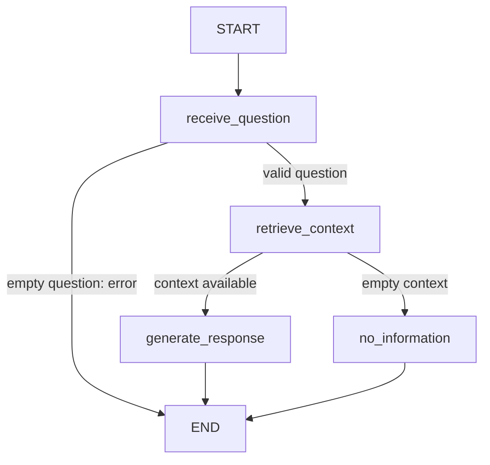

# TrackFlow Support Agent - Part 1

LangGraph orchestration of the existing RAG, not a replacement implementation.
No conversation memory, new tools, automatic retries or changes to the corpus,
models, prompts, top-k or score threshold are introduced.

## Graph and state



`AgentState` has only `question`, `context`, `answer` and `error`. Pydantic
validates types at runtime; no chat history or external clients travel in state.
The retrieval node calls `data.pipelines.rag.retrieve` once. The generation node
calls `generate_answer(question, context)` with those recovered chunks.
`no_information` reuses the existing empty-context fallback, without an LLM call.
`embed` remains the existing function imported by the RAG pipeline. The old
`query` remains in use by the old endpoint; the graph never calls it.

Initialization explicitly compiles the graph before accepting HTTP requests.
Additional checks reject disconnected nodes, missing paths to END, implicit
conditional destinations and the wrong state schema. Compilation is not a
substitute for runtime type validation or dependency availability checks.

## HTTP

Install from the repository root:

```bash
uv sync
```

The root workspace declares `packages/shared-py` as a local editable dependency.
`uv sync` therefore installs `trackflow_shared` automatically, including the
dependency required by the unified API integration test. A manual `uv pip install`
or `--no-sync` workaround is not required.

The unified API includes `POST /agent/query`, alongside `POST /knowledge/query`.
It can also run independently of the rest of the API:

```bash
uv run uvicorn support_agent.api:app --app-dir services --host 0.0.0.0 --port 8001
curl -X POST http://localhost:8001/agent/query \
  -H 'Content-Type: application/json' \
  -d '{"question":"Cual es la tarifa de almacenamiento en Zaragoza?"}'
```

Successful responses contain `answer`, `run_id` and `thread_id`, never chunks or
scores. Empty questions produce a traced `400`; invalid request bodies produce
`422`. Dependency failures produce `503`, internal graph failures `500`, with
sanitized messages and the run ID. Empty retrieval is a successful, honest
response, not an HTTP error. The adapter contains no retrieval or prompt logic.

Real questions require the same indexed Qdrant collection and model credentials
as the existing RAG. The standalone service reads the existing environment;
it introduces no new required secret.

## Persistence and inspection

`SUPPORT_AGENT_STATE_DIR` optionally selects the state directory. The local
default is `~/.local/state/trackflow/support_agent`. Compose maps
`./data/support_agent` to `/var/lib/trackflow-agent`, surviving container
recreation. Do not delete that directory if runs must remain inspectable.

- `checkpoints.sqlite3`: official LangGraph `SqliteSaver`, checkpointing at
  superstep boundaries (one node per step in this graph).
- `traces.sqlite3`: persistent JSON documents with run/thread IDs, input,
  ordered node events, node inputs/outputs, branch destinations/reasons,
  timing, final answer and sanitized errors. Node start is persisted before
  its execution. Each resume attempt has its own run ID and the same thread ID.
- Trace metadata records graph/RAG/corpus hashes, generation model, retrieval
  settings and whether external services were simulated.

From the repository root, inspect without rerunning the graph:

```bash
uv run python -m services.support_agent trace RUN_ID
uv run python -m services.support_agent history THREAD_ID
uv run python -m services.support_agent resume THREAD_ID
```

Use `--state-dir PATH` before the command when inspecting another directory.
Resumption continues a pending or failed checkpoint; completed threads cannot
be resumed. Independent questions always receive distinct thread IDs. Checkpoint
replay does not guarantee exactly-once external calls if a process dies between
the call and its persisted checkpoint.

Traces/checkpoints include user questions and internal knowledge. They are
local-only, not exposed by a public trace endpoint. Restrict directory access
and define appropriate retention/backups before production. SQLite and the
execution lock target a single-process deployment, not distributed workers.

## Evaluation

Run all pipeline tests, including existing RAG tests, with one command:

```bash
uv run python -m pytest tests/pipelines/ -q
```

The five evals in `tests/pipelines/test_support_agent_evals.py` read saved traces,
not live executions. They check retrieval-before-generation and exact context
reuse, the Zaragoza storage policy, empty-context routing, empty-question
rejection, and rejection of a wrong answer even with correct routing.
The grounding check compares the saved answer/context with the official policy
in `docs/company-knowledge-base/trackflow-storage-pricing.es.md`, not invented
company context. Hash mismatches require review and explicit recapture; never
change expected business facts to match an incorrect generated answer.

Other tests execute the graph offline to verify nodes, structural rejection,
runtime types, persistent checkpoints, restart/resume without a second retrieval,
failure traces, HTTP errors and unified API startup.

Reference traces are **simulated**, not evidence of live-model faithfulness:
they were generated by running the real graph, RAG functions and in-memory
Qdrant against the official corpus, with simulated embeddings and LLM output.
Regenerate explicitly, outside pytest:

```bash
uv run python tests/pipelines/capture_support_agent_traces.py --offline
```

For real captures, first start Qdrant and index the existing corpus using the
existing RAG setup procedure, then run:

```bash
uv run python tests/pipelines/capture_support_agent_traces.py
uv run python -m pytest tests/pipelines/ -q
```

The capture command uses existing retrieval/generation unchanged; live mode does
not reindex or mutate the collection. Passing stored evals proves properties of
those captures, not all future answers. Live-model validation remains required
before treating the migration as production-validated.